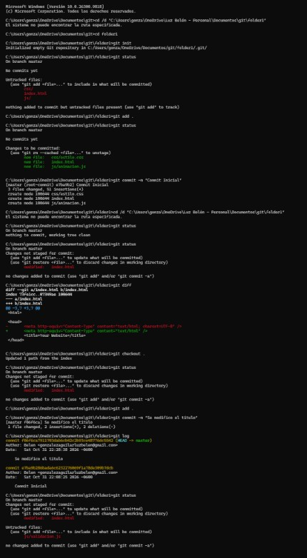
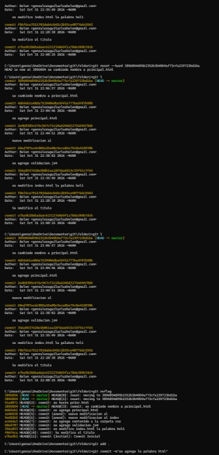
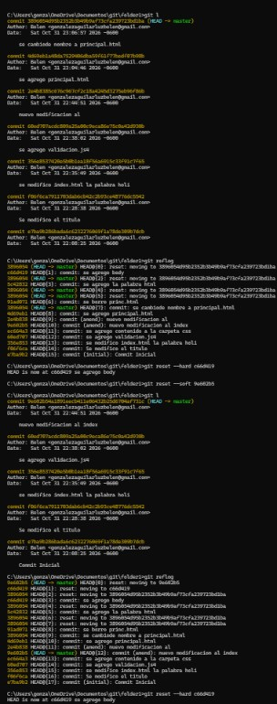
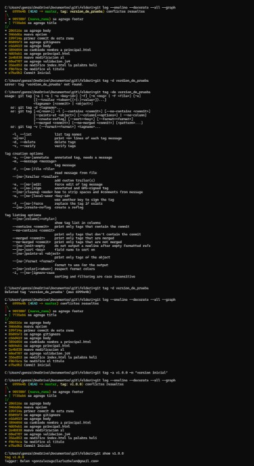
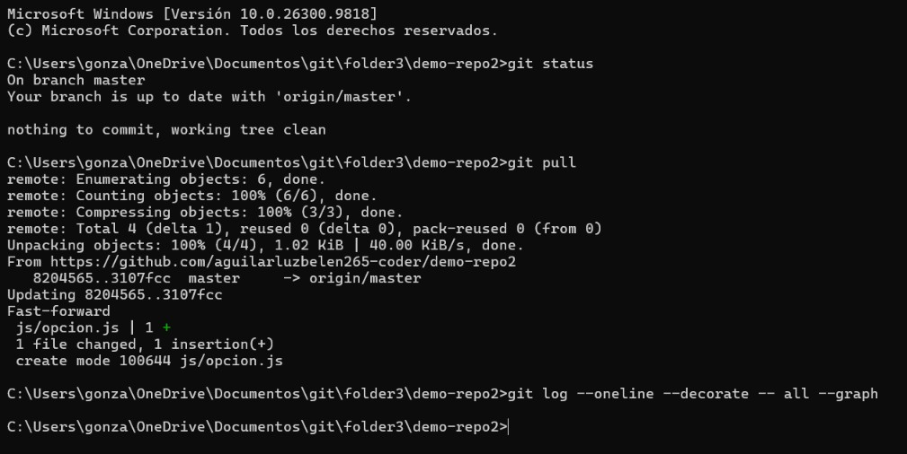
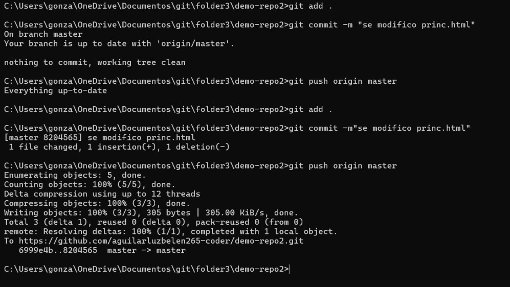

# tarea
Repositorio curso git
Comprendi la importancia de Git como un sistema de control para registrar los cambios en el codigo a lo largo del tiempo,aprendi a diferenciar la funcionalidad de los diferentes comandos,asi como el uso y la creacion de un repositorio
COMANDOS:
-git init:inicializa un repositorio git en la carpeta local del proyecto
-git status:muestra el actual en el que se encuentra el directorio de trabajo
-git add .:agrega archivos del directorio de trabajo al area de preparacion
-git commit -m:guarda de forma permanente los cambios preparados en el historial del repositorio local 
-git push -u origin master:se utiliza para subir cambios locales a un repositorio remoto

